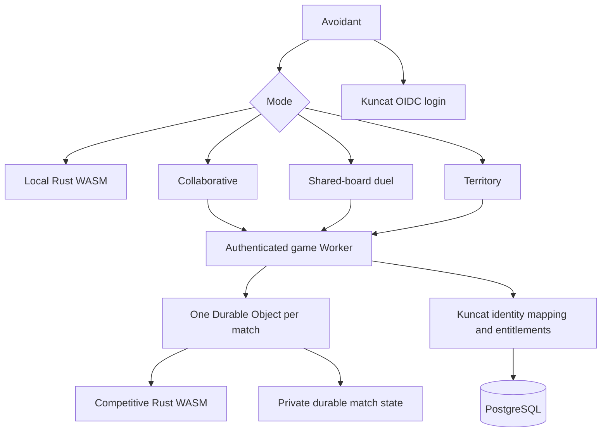
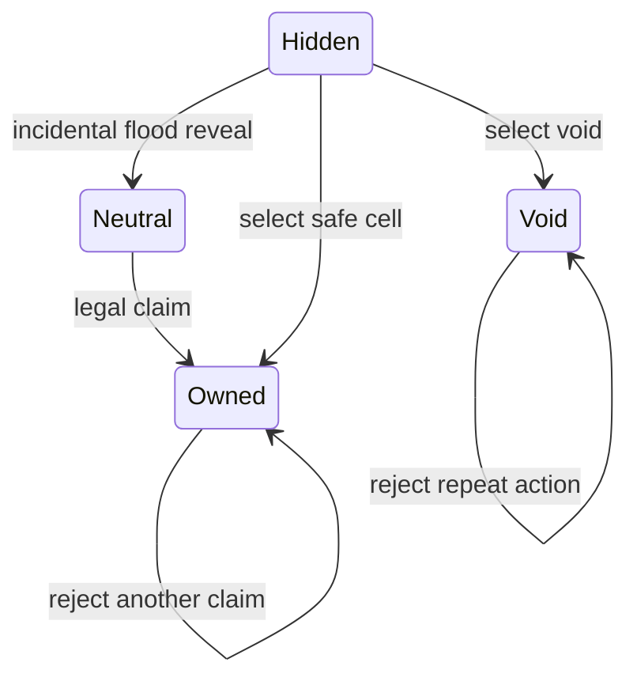
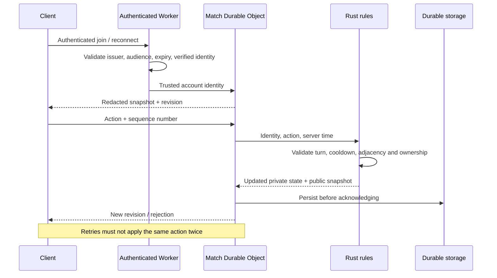
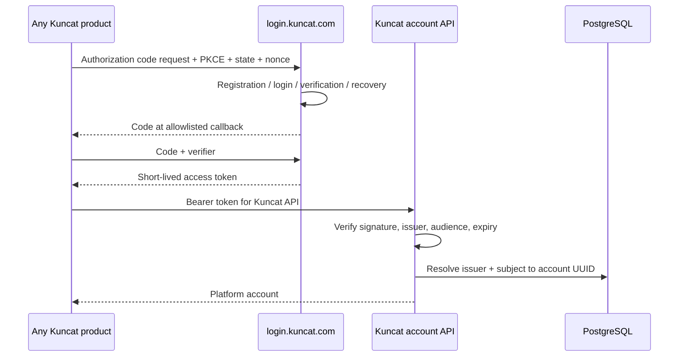
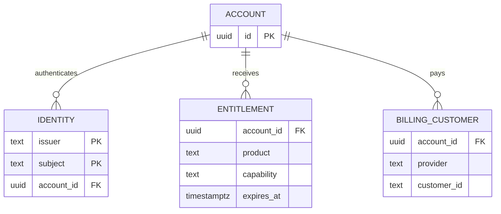
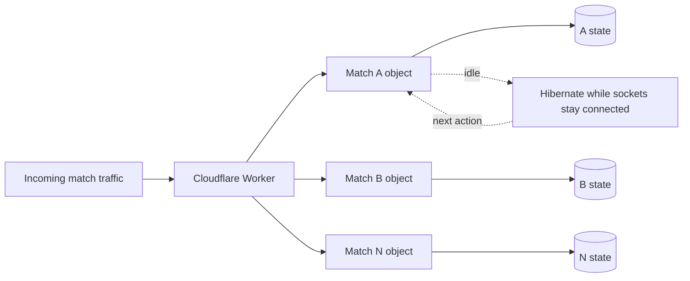
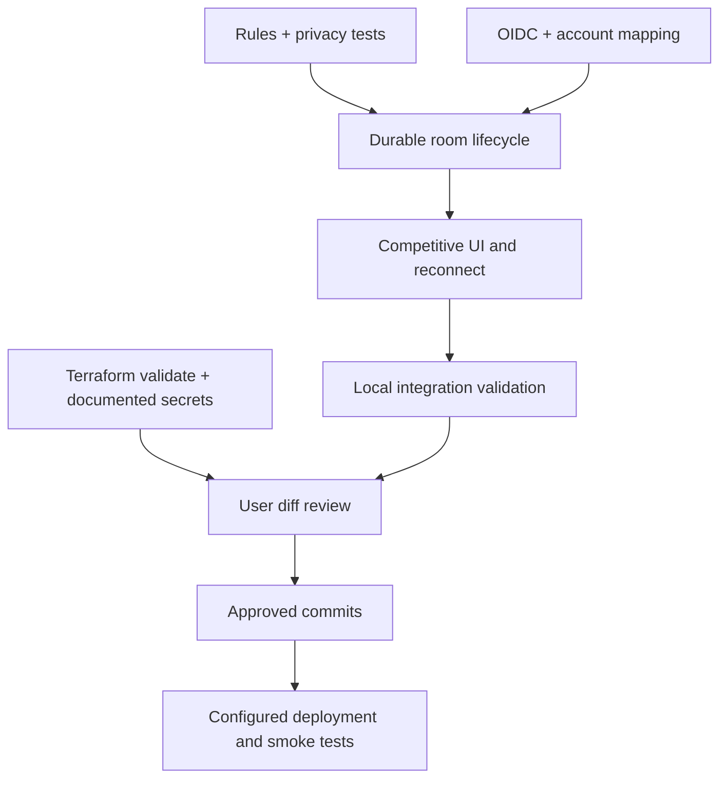
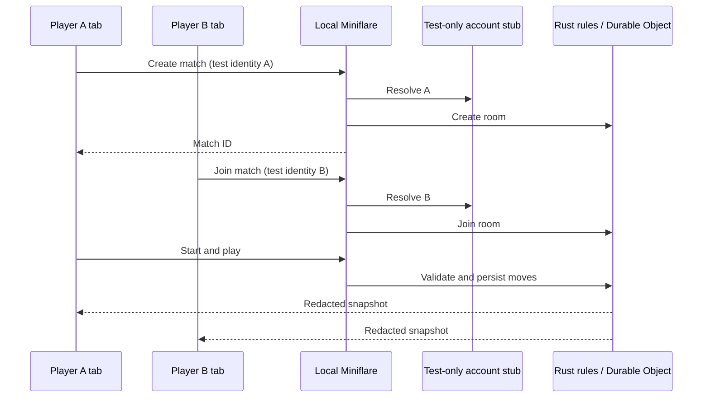
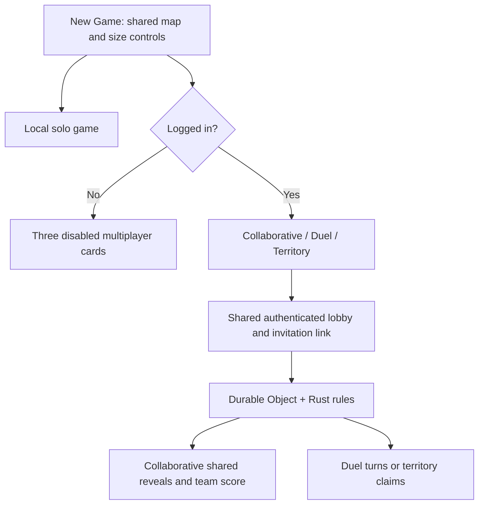

# Multiplayer and Kuncat accounts

Status: implemented locally and undergoing final review; no production provisioning or commits yet.

## Boundaries

Solo remains local without login. Collaborative, shared-board duel and territory
all require authenticated accounts and a trusted game server. The server owns
hidden information, validates moves and publishes only a public projection.
Kuncat accounts belong to the platform, not Avoidant or games.kuncat.com.



## Rules to implement

Duel is turn-based, two players, one selected cell per turn. Only the selected
cell scores (+1 safe, -5 void); flood cells supply public information and earn no
points. No extra turns or global completion bonus. End when all safe cells are
revealed, all players pass consecutively, or the match deadline expires. Ties
are draws. Collaborative mode instead sums teammate contributions: each newly revealed safe
cell adds one team point and a void costs five; there is no individual winner.
It supports 2–8 players, no turns or territory ownership, and late joins during
play. The shared goal is to reveal all safe cells before the session deadline.

Territory supports 2–8 players with three immutable lobby options:

| Option                                | Representation               | Meaning                                                                 |
| ------------------------------------- | ---------------------------- | ----------------------------------------------------------------------- |
| Claims must border existing territory | boolean                      | A safe claim must share an adjacency edge with an owned cell            |
| Flood limit                           | non-negative integer or null | Additional revealed cells beyond the selected cell; null means infinity |
| Turn-based                            | boolean                      | Rotate one action per player, or accept rate-limited real-time actions  |

Flooding reveals neutral cells, never additional ownership. Revealed neutral
safe cells can be selected and claimed later. Owned cells cannot be stolen.
A revealed void is not a valid action. A hidden void costs five points, consumes
the turn/cooldown, and grants no ownership. Territory ranking uses claims minus
void penalties. Validate these balance choices through playtesting.

Assign distinct, server-selected safe starting cells before play. They count as
one territory each and do not flood. The void layout uses independent secret
randomness, never the public geometry seed. Starts are guaranteed safe but not
claimed to be equally advantageous. Initial competitive maps are server-approved
catalog entries generated with the existing map generator; arbitrary client
adjacency is never accepted as authoritative.

A finite flood walks adjacency breadth-first, with cell-index ordering to break
ties. Count only newly revealed cells. Flood traversal may cross already-revealed
zero cells, allowing later actions to continue a capped flood. Limit zero reveals
only the selected cell. In territory mode a claim on a revealed zero can resume
flooding. The UI must distinguish hidden, neutral revealed, owned, and void cells.



Border rules apply to attempts as well as claims; otherwise an illegal distant
probe could leak hidden information. Starting territory solves the first-claim
exception. Stop territory play when all safe cells are claimed, all players pass
in turn-based play, or a deadline expires. Disconnected players retain ownership;
turn deadlines advance stalled turns. Regions cut off by voids or rival territory
may remain neutral at the end. Do not reveal them to decide legal moves.



## Platform identity decision

Recommendation: managed Auth0 Universal Login at login.kuncat.com, standard OIDC
Authorization Code + PKCE, using an established client library and JOSE verifier.
Do not implement passwords, recovery or an OAuth authorization server ourselves.
Each product gets its own client and exact callback allowlist. No wildcard
redirects, shared parent-domain session cookies, browser client secrets, or email
addresses as primary keys. Browser tokens stay in memory, not localStorage.

A PostgreSQL Kuncat account UUID maps to `(issuer, subject)`; do not automatically
link identities by email. Product entitlement rows reference the platform UUID.
Identity-provider replacement can preserve product data through deliberate account
linking/migration. Provider password migration still requires a separate plan.





Do not bill in this release. Introduce server-side admission checks keyed by
product and capability. Later signed, idempotently processed billing webhooks
update entitlements; clients cannot grant them. Keep payment provider IDs out of
game rules. Decide later whether subscriptions cover hosts, each participant, or
both. Failed entitlement lookups must fail closed for paid modes.

## Cost and hosting decision (checked 2026-10-07)

- Auth0 Free advertises 25,000 MAU and one custom domain (card verification for
  custom domain). Essentials starts at $35/month for 500 MAU in the displayed
  tier; advanced feature requirements can force upgrades. Verify the chosen
  tenant's limits before rollout: https://auth0.com/pricing.
- Better Auth is an alternative established TypeScript auth library with OIDC
  provider support. Self-hosting adds database, email, incident response and
  upgrade responsibilities: https://better-auth.com/docs/plugins/oauth-provider.
- Cloudflare SQLite Durable Objects have a free tier. Paid Workers has a $5/month
  minimum plus usage; room storage and compute are metered. Hibernation prevents
  idle WebSockets from keeping room execution billable. Free quotas fail requests
  when exhausted, rather than providing production capacity guarantees:
  https://developers.cloudflare.com/durable-objects/platform/pricing/.
- The supplied PostgreSQL adapter uses Neon HTTP queries. Reuse an existing Neon
  project or use the optional Neon Terraform root; another PostgreSQL host needs
  an adapter change (for example a pooled TCP driver via Hyperdrive). Production backup retention and recovery
  requirements must be priced separately from an introductory free tier.
- Existing Fly relay costs remain independent and unchanged.



Autoscaling means independent matches activate as needed; a single room remains
serialized. Bound players, cells, payloads, pending messages and match lifetime.
Use alarms for deadlines and cleanup, not interval loops. Persist private state
before broadcast; restore it after eviction. Pin the rules/protocol version per
match and drain incompatible old matches before changing state schemas.

## Repository and delivery plan

1. Avoidant: pure Rust competitive rules + tests, WASM server binding, trusted
   map catalog, TypeScript match service, client adapter, mode/lobby UI and ownership.
2. kuncat.com: reusable account client/service under a platform-level directory,
   registration/login integration and PostgreSQL migrations. Games consumes it.
3. infra: isolated Terraform roots for platform identity and competitive services;
   avoid an incidental Cloudflare v4-to-v5 migration of the existing relay root.
4. Verify rules, privacy projection, duplicate/stale actions, reconnect/eviction,
   wrong issuer/audience/expired tokens, CORS, missing entitlement and local UI.
5. Review all repository diffs with the user. Commit only after explicit review
   approval. Provisioning requires actual tenant, account and secret configuration;
   never claim a deployment is live based on local build success.



## Review handoff

Implemented across Avoidant, sibling kuncat.com, and sibling infra:

- Collaborative play now shares the authenticated authority with duel and territory; the peer-hosted menu path is removed.
- Competitive Rust rules run only on the trusted match authority; clients receive
  public snapshots and use a separate board adapter. Territory visibility and
  ownership are separate, with all three requested setup options.
- Kuncat account registration/login/recovery is delegated to Auth0 Universal Login;
  the reusable client uses PKCE and expiring rotating refresh tokens in memory.
  PostgreSQL stores provider-independent account IDs and future entitlements.
- Cloudflare Workers/SQLite Durable Objects provide per-match activation and
  hibernation. Terraform configures Auth0 and optionally Neon; a Terraform-driven
  Wrangler helper publishes the two Workers and their domains/migrations.

Validation includes Rust rules and existing game regressions, existing JavaScript
unit tests, JWT verification tests, local Worker tests (including runtime restart,
expired sockets, ticket replay and invalid settings), a two-browser 3D-click flow,
PostgreSQL first-login concurrency/permissions checks, package/site builds and
Terraform validation. Live provider login, email delivery and deployed-region
latency remain production smoke tests after credentials are configured.

Initial limits and review choices: competitive maps use all eight shapes at three standard sizes; flood limit counts additional cells; each selected safe cell scores one,
voids cost five; starts are spread out but not guaranteed equal in difficulty.
The match clock is 20 minutes with 30-second turns. New competitive UI copy is
English. Billing, long-term match history and leaderboards are not implemented.

No infrastructure apply, package publication or commits have been performed.
Proposed review/commit groups: Avoidant gameplay/server, Kuncat account/site
integration, and infrastructure. User approval is required before committing.

Final local results: 33 Rust tests, 24 existing JavaScript tests, 6 identity tests,
5 Worker integration tests, the two-browser terrain-click test, and PostgreSQL
concurrency/privilege checks passed. Svelte/TypeScript checks, package validation,
Astro build and all three Terraform roots passed validation. The site's compatible
lockfile security updates remove its production audit findings (zero reported);
remaining npm audit findings concern development tooling and were not force-upgraded.

## PostgreSQL 18, Svelte hosting and local development

The new database now provisions PostgreSQL 18. Version 17 was a conservative
initial default, not a dependency constraint; Neon supports 18 and the account
migration, concurrent first-login resolution and runtime privileges pass on 18.
No database has been provisioned, so this is not an in-place major upgrade.

The games site now uses Svelte and Vite directly. It retains static `dist` hosting,
lazy-loads Avoidant at `/avoidant`, and uses Cloudflare's SPA asset fallback for
navigation and OIDC callbacks. Astro and its integrations are removed.

```mermaid
flowchart LR
  Static[Cloudflare static assets] --> Shell[Svelte landing page]
  Static --> Route[/avoidant route]
  Route --> Lazy[Lazy-loaded game and account client]
  Lazy --> OIDC[Kuncat login]
  Lazy --> Authority[Trusted multiplayer Worker]
```

`npm run dev:multiplayer` rebuilds the WASM and Worker and starts the local test
harness. Two printed URLs select distinct in-memory test identities. Create a
match in one tab, join its ID in the other, then start. This tests gameplay without
cloud provisioning; real registration/login still needs a development identity
provider and the account service. See `server/README.md` for prerequisites.



The shared harness also drives the automated two-browser smoke test. Its identity
stub lives exclusively in test tooling; production Worker authorization is unchanged.

Package management is standardized on npm across Avoidant, the trusted server,
the games site and shared account service. Each installable service uses an npm
`package-lock.json` and `npm ci`; Terraform's Worker deployment helper uses the
same commands and hashes those lockfiles. No pnpm installation is required.

Competitive invitations use the product's existing game route with a `match` query
parameter. They open competitive mode, preserve the match through login, and join
with the recipient's identity. Links contain no bearer token or local test actor.
Confirmed reveal deltas drive the existing board shader's pulse sweep and delayed
void fall; initial snapshots render immediately without replaying
historical moves. Cosmetic animation never modifies the trusted match state.

Local multiplayer uses the normal `/` route and menus. The launcher injects a
development-only account client and authority URL; production builds omit this
configuration. There is no special smoke-test page. Competitive map geometry is
server-approved for eight shapes and three standard sizes; arbitrary custom seeds,
sizes and terrain settings remain available in solo configuration.
Territory ownership uses eight fragment-shader patterns as well as color, with
no additional draw calls. Cells show only adjacent-void counts, including zero
when flooding is finite.

## Unified setup and trusted collaboration

New Game contains one map-shape selector, one illustrated size selector, and
Solo plus three illustrated multiplayer choices. Multiplayer buttons and Join
are disabled until login; the local launcher supplies a test account through
the same account interface. There is no separate competitive configuration form.
Mode-specific flood/territory settings appear in this shared form. Unsupported
custom multiplayer settings are disabled instead of silently ignored. Legacy
relay settings, peer invitations and peer joins are removed from the application.
The games site no longer supplies the old relay URL. No infrastructure is destroyed.



The shared setup uses DaisyUI buttons, selects, inputs and checkboxes. Solo and
all three multiplayer modes have SVG illustrations in matching cards. Map-size
illustrations use irregular quadrilaterals and triangles rather than a hexagonal
grid. The same DaisyUI plugin and themes are configured for development and the
production games site.
