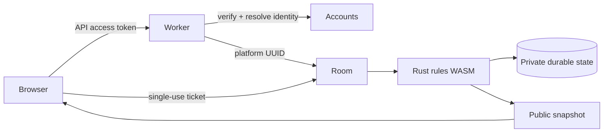

# Trusted multiplayer server

All three multiplayer modes, including collaborative play, run Rust rules as WASM
inside one Cloudflare SQLite Durable Object per match. Every mode requires login.
The outer Worker delegates bearer-token verification and platform UUID resolution
to Kuncat accounts. Each lobby join obtains a single-use 30-second WebSocket ticket.
Only redacted snapshots leave the room. Private state is stored before broadcast.
The room uses WebSocket hibernation and storage alarms rather than interval loops.



## Build and test

From this directory, with Node 24+ (including npm), Rust and wasm-pack installed:

```sh
npm ci
npm run build:rules
npm run check
npm run build
npm test
```

`npm run build` is a dry run and writes a bundle for integration tests. `npm test`
uses local Miniflare with a test-only account-service stub; production has no auth
bypass. Rebuild WASM and the Worker bundle after Rust changes before testing.
Rust unit tests run from the repo root with `cargo test -p avoidant-competitive`.

The committed catalog is public geometry from the existing Rust map generator:

```sh
node tools/update-catalog.mjs
```

Review catalog changes as protocol changes. Clients compare received adjacency
against regenerated geometry and reject incompatible boards. Competitive v1 offers
all eight shapes at small/medium/large sizes, 15.625% void density and a public geometry seed of 42.
Private void layouts use independent 256-bit server entropy and ChaCha20. Existing
solo custom maps remain available through their original path.

## Interactive local multiplayer

One-time setup requires Node 24+ (including npm), Rust, and wasm-pack:

```sh
# From the Avoidant repository root:
npm ci
npm --prefix server ci
npm run dev:multiplayer
```

The command rebuilds browser WASM, trusted rules and the Worker, then starts the usual game page in Vite
and Miniflare bound to loopback. Open both printed URLs in ordinary browser tabs,
then choose **New Game** and **Collaborative**, **Duel**, or **Territory**:

- Player 1: http://127.0.0.1:5174/?actor=a
- Player 2: http://127.0.0.1:5174/?actor=b

Create a match in the first tab and copy its invitation link. Open the second
player URL once to select that local identity, then follow the invitation link in
that tab and start from the first. On another machine, following the invitation
directly creates a distinct test identity automatically. Manual Match ID entry
is also available. Choose collaborative, duel or territory and vary the flood, border and turn options.
For more territory players, use `actor=c`, etc. Tabs use distinct test identities,
so private browsing is unnecessary. Ctrl+C stops both servers. Room data is ephemeral. Ports 5174 and 8799 must be free.

To join from another machine on the same LAN, stop the launcher and restart with
`--host` (the printed URL uses an auto-detected IPv4 address):

```sh
npm run dev:multiplayer -- --host
# Select an address explicitly, e.g. if the host has VPN/container interfaces:
npm run dev:multiplayer -- --host 192.168.1.20
```

Both servers then bind to `0.0.0.0`, and the printed URLs use that LAN address.
Open the printed Player 2 URL on the other machine. The browser derives the game
server address from its page hostname; the Worker permits the configured LAN
origin. Allow inbound TCP ports **5174 and 8799** in the host firewall if needed.
Use only a trusted LAN: this harness deliberately accepts fake player identities
and is not suitable for public exposure. Without `--host` it stays loopback-only.

This exercises the real Rust authority and WebSockets, with only the external
account service replaced inside Miniflare. It needs no cloud account, PostgreSQL,
or paid deployment. Production code contains no authentication bypass. To test
actual registration/login, configure the development identity and account services.

## Local and production configuration

Set ACCOUNT_API to a configured Kuncat account Worker and ALLOWED_ORIGINS to exact
client origins. The site supplies public configuration described in the sibling
`kuncat.com/games/.env.example`. No browser or test flag can bypass production auth.
Local UI testing therefore needs a development identity tenant, or a test harness
that replaces the external account service only inside Miniflare.

Use the sibling infra `platform/multiplayer` Terraform root for production. It
builds and publishes both Workers using Wrangler and provisions their custom
domains and Durable Object migration. Creating a match requires `games:host`;
joining requires a verified Kuncat account without a subscription.
Billing/checkout is not implemented.

Current bounds: 2–8 players for collaborative and territory, 16 sockets per room, 60 lobby
requests/account/hour, 10 messages/socket/second, 400 ms action cooldown, host-configured
turns (1–86400 seconds or disabled; default 30), matches (1–1440 minutes from start; default 20), 10-minute unstarted-lobby expiry, one-minute completed
match retention. Persisted rules version is checked on every transition. Login
expiry is enforced on moves; reconnect obtains fresh verified authorization.

Potential production follow-ups: fair-start evaluation,
rankings/results retention, graceful account deletion, telemetry/alerts, broader
localization, and multi-region latency playtesting. These are distinct from the
implemented game-state authority. Durable Objects scale across matches; one match
is a serialized unit and is bounded accordingly.

`npm run test:ui` additionally drives two Chromium pages through territory setup,
lobby join, 3D rendering, turns and completion. Install the root npm dependencies
and a Playwright browser first (or set PLAYWRIGHT_CHROMIUM_EXECUTABLE to an existing
Chrome executable). This test follows the regular menu and invitation flow using dev-only account configuration.
The root Cargo.lock is now tracked because server releases need locked Rust builds.

Player names reuse the browser’s `avoidant:playerName` preference and default to the signed-in profile username when no custom name is saved. The authoritative lobby validates and broadcasts names; names stay fixed during play. Restart the local multiplayer launcher after server/rules changes so its bundled Worker includes the latest protocol.

## First exploration, Territory scores, and replay

On a board with no revealed cells, the first accepted selection is guaranteed
safe. If it selects a void, the rules swap that void with the lowest-index safe
cell before revealing anything, preserving the void count. Once any cell is
revealed, the void layout is fixed; this does not grant each player a separate
safe first move. Bordering matches already reveal safe starting territories.

Territory scores equal the number of cells owned. Discovering a void does not
subtract points; flood reveals remain neutral until individually claimed.
Collaborative scoring retains its existing void penalty, and solo is unchanged.

The initial private state contains the original void layout. Recorded commands
contain the selected cell and server time, and each command references the
archived rules engine hash. Relocation uses no new randomness, so replay applies
the same swap. Archived engine bundles preserve historical rules across future
deployments; initial-state and replay endpoints remain participant-only.

## Shared invitation URLs

Production binds `INVITATIONS` to the `AvoidantInvitations` entrypoint of the
`kuncat-invitations` Worker managed in `infra/platform/multiplayer`. Creating or
joining a room returns its `https://kuga.run/ABCDE` URL. Join accepts a bare code,
a kuga.run URL, or an existing UUID invitation; internal match IDs remain UUIDs.
The global registry allocates five-letter codes across both games and supports
4–32-letter inputs for future growth. It is not on the gameplay message path.

Room cleanup removes playable state before retiring its mapping. Failed registry
notifications retain a durable retry marker. The registry returns 404 for retired
links and permits reassignment only after a further 48 hours. Active matches are
never retired merely because a redirect or registry request failed. Local
harnesses without the binding keep their UUID URLs.

### Chat previews

Admission registers only the public map preset, mode, and bordering setting with
kuga.run. Reconnecting also updates an existing invitation's settings; legacy
links use a generic map card until then. Preview requests never enter the game
room or read hidden voids or player identities.

To regenerate the committed PNG cards in the sibling infra repo:

```sh
npm run build:wasm
node server/tools/share-previews.mjs
```

The generator uses the real seeded map polygons, plus the games site's Karrom
canvas renderer, and requires Playwright Chromium and installed server build
tools. Its optional arguments are the output directory and Karrom `board.ts`
path. Change the asset version directory and image URL prefix together when
replacing published artwork, since images are immutable-cacheable.
